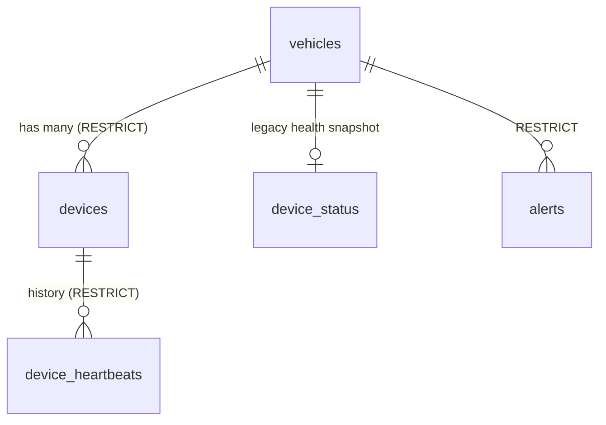
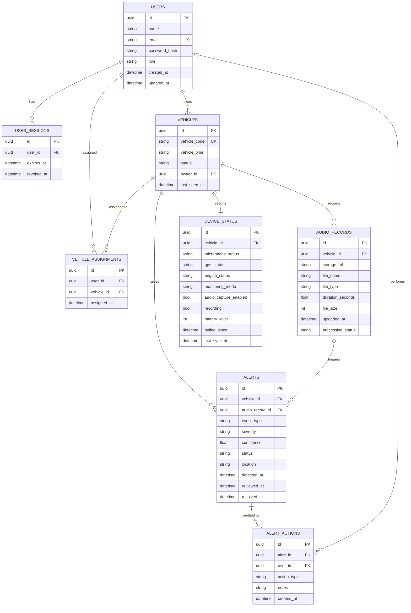
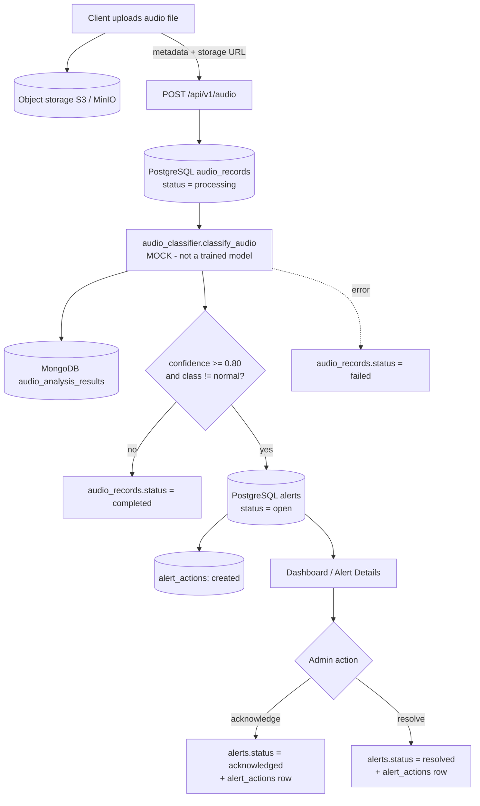

# Database design

The system uses two databases, each for what it does best.

- **PostgreSQL** – relational and transactional data (accounts, vehicles, alerts, audit trail).
- **MongoDB** – high-volume, flexible, time-series-like data (telemetry, ML output, logs).
- **Object storage (S3 / MinIO)** – audio files. Databases hold only the URL and metadata.

## PostgreSQL tables

All primary keys are UUIDs. Timestamps are timezone-aware (UTC). Enum-like columns are plain
strings validated by the API (no PostgreSQL ENUM types, so adding a value needs no migration).

### `users`
| Column | Notes |
| --- | --- |
| `id` | UUID PK |
| `name`, `email` | `email` unique + indexed (stored lower-case) |
| `password_hash` | bcrypt hash (SHA-256 pre-hashed to avoid the 72-byte limit). Never plain text |
| `role` | `admin` or `user` |
| `created_at`, `updated_at` | |

### `user_sessions` (refresh/revocation support)
One row per issued token; its `id` is the JWT `jti`. `expires_at`, `revoked_at`. `POST /auth/logout`
sets `revoked_at`, so a stolen token stops working immediately.

### `vehicles`
`id`, `vehicle_code` (unique, indexed, e.g. `CAR-1024`), `vehicle_type`, `status`
(`connected` / `disconnected` / `maintenance`), `owner_id` → `users`, `last_seen_at`,
`created_at`, `updated_at`.

### `vehicle_assignments`
`id`, `user_id` → `users`, `vehicle_id` → `vehicles`, `assigned_at`; unique on
`(user_id, vehicle_id)`. A user can access a vehicle they own or are assigned to; admins see all.

### `audio_records`
`id`, `vehicle_id` → `vehicles` (indexed), `storage_url`, `file_name`, `file_type`,
`duration_seconds`, `file_size`, `uploaded_at`, `processing_status`
(`pending` / `processing` / `completed` / `failed`).

### `alerts`
`id`, `vehicle_id` → `vehicles` (indexed), `audio_record_id` → `audio_records` (nullable),
`event_type`, `severity` (`low` / `medium` / `high` / `critical`), `confidence` (0–1),
`status` (`open` / `acknowledged` / `resolved`, indexed), `location`, `detected_at` (indexed),
`reviewed_at`, `resolved_at`.

### `alert_actions`
Audit trail. `id`, `alert_id` → `alerts` (indexed), `user_id` → `users` (null for system-created),
`action_type` (`created` / `acknowledged` / `resolved`), `notes`, `created_at`.

### `device_status`
Latest health snapshot, one row per vehicle (unique `vehicle_id`): `microphone_status`,
`gps_status`, `engine_status`, `battery_level`, `last_sync_at`, plus control state
(`monitoring_mode`, `audio_capture_enabled`, `recording`) and `online_since` (start of the current
connected period; drives the uptime display). Updated whenever telemetry arrives.

### `devices` (IoT devices; many per vehicle)
`id` (UUID PK), `vehicle_id` → `vehicles.id` (**RESTRICT**), `hardware_id` (**unique**, required), `device_name`,
`device_type` (microphone, audio_sensor, gps, imu, camera, gateway, other), `manufacturer`, `model`,
`firmware_version`, `status` (PENDING, ACTIVE, WARNING, DELAYED, DISABLED, RETIRED), `is_active`, `last_seen_at`,
`registered_at`, `removed_at`, `created_at`, `updated_at`. Device-level controls: `monitoring_mode`,
`audio_capture_enabled`, `recording`, `online_since`, `battery_level`, `configuration` (JSON), `api_key_hash` (SHA-256).
Indexes: `vehicle_id`, `hardware_id` (unique), `status`, `last_seen_at`, `(vehicle_id, status)`.

### `device_heartbeats` (append-only history)
`id`, `device_id` → `devices.id` (**RESTRICT**), `received_at`, `heartbeat_status` (ok/warning/error), `battery_level`,
`signal_strength`, `firmware_version`, `latitude`, `longitude`, `metadata` (JSON), `created_at`.
Indexes: `device_id`, `received_at`, `heartbeat_status`, `(device_id, received_at)`.

**Lifecycle and timing**: heartbeat from PENDING/DELAYED/ACTIVE/WARNING sets ACTIVE (or WARNING when the heartbeat
status is not `ok` or battery < 15 %); no heartbeat for 300 s (`DEVICE_HEARTBEAT_TIMEOUT_SECONDS`) turns ACTIVE/WARNING
into DELAYED. DISABLED and RETIRED are only changed by an administrator. Retired devices reject commands, heartbeats and telemetry.

**Soft deletion**: `vehicles` gained `is_active` and `deleted_at`; `DELETE /vehicles/{id}` and `DELETE /devices/{id}`
never remove rows. `alerts.vehicle_id`, `audio_records.vehicle_id`, `devices.vehicle_id` and
`device_heartbeats.device_id` use `ON DELETE RESTRICT`, so historical records cannot be lost by deleting a vehicle row.
`vehicle_code` (unique) and `vehicle_type` were already columns of `vehicles`.

**MongoDB**: `telemetry_events`, `sensor_events` and `device_logs` documents may carry `device_id` and `hardware_id` in
addition to `vehicle_id` (older documents remain valid). New indexes: `(device_id, timestamp)` and sparse `hardware_id`.

## Entity relationships

Deleting a vehicle removes its assignments, audio records, alerts, alert actions and device
status. Vehicles are no longer hard-deleted: the API performs a soft delete (`is_active=false`, `deleted_at`) and keeps
every related record. MongoDB history is intentionally retained.

## MongoDB collections

Vehicles are referenced by `vehicle_code` (not the PostgreSQL UUID) so documents stay readable
and devices can write without a lookup. Timestamps are stored as UTC datetimes.

| Collection | Document |
| --- | --- |
| `telemetry_events` | `vehicle_id`, `timestamp`, `location{latitude, longitude}`, `speed`, `engine_temperature`, `battery_level`, `gps_status` |
| `audio_analysis_results` | `audio_record_id` (PostgreSQL UUID as string), `vehicle_id`, `model_name`, `model_version`, `predicted_class`, `confidence`, `processing_time_ms`, `created_at` |
| `sensor_events` | `vehicle_id`, `sensor_type`, `value`, `unit`, `timestamp` (derived from each telemetry post) |
| `device_logs` | `vehicle_id`, `event_type`, `message`, `timestamp` |

## Indexing strategy

| Store | Index | Serves |
| --- | --- | --- |
| PG | `users.email` (unique) | login / duplicate check |
| PG | `vehicles.vehicle_code` (unique) | lookup by code |
| PG | `alerts.vehicle_id`, `alerts.status`, `alerts.detected_at` | per-vehicle lists, active-alert counts, newest-first ordering |
| PG | `audio_records.vehicle_id`, `device_status.vehicle_id` (unique) | per-vehicle lookups |
| PG | FK columns on assignments, sessions, actions | access checks, joins |
| Mongo | `telemetry_events.vehicle_id`, `.timestamp` | single-field filters |
| Mongo | `telemetry_events (vehicle_id, timestamp)` | "latest reading" and history range queries |
| Mongo | `audio_analysis_results.vehicle_id`, `.predicted_class` | analytics grouping and filtering |
| Mongo | `sensor_events` / `device_logs (vehicle_id, timestamp)` | history queries |

Mongo indexes are created idempotently at API startup. For long-running telemetry, consider a TTL
index or time-series collection to bound storage.

## CRUD design

| Resource | Create | Read | Update | Delete |
| --- | --- | --- | --- | --- |
| User | `POST /auth/register` | `GET /auth/me`, `/users/me` | `PATCH /users/me` | – |
| Vehicle | `POST /vehicles` (any user; admin may set owner/assignees) | list (scoped), get | `PATCH` (owner/admin) | `DELETE` (owner/admin) |
| Audio | `POST /audio` (runs the workflow) | list, get (+ analysis) | `PATCH /audio/{id}/status` | – |
| Alert | `POST /alerts` (manual) or automatically | list (filter by vehicle/status), get (+ actions, analysis) | `acknowledge`, `resolve` (admin) | – |
| Telemetry | `POST /telemetry/{vehicle}` | history (range + limit), latest | – (append-only) | – |

Access rule everywhere: non-admin users only touch vehicles they own or are assigned to;
anything else returns `404`. Every write commits in one PostgreSQL transaction in the service layer.

## Audio-to-alert data flow

Telemetry flow: `POST /telemetry/{vehicle}` → MongoDB `telemetry_events` (+ `sensor_events`) →
PostgreSQL `device_status` and `vehicles.last_seen_at` are refreshed → the Live Map and Car
Monitoring pages read the latest document.

Analytics: `total_events`, `average_confidence`, events-over-time and events-by-type come from
MongoDB `audio_analysis_results`; `critical_events` (severity `high`/`critical`),
`resolution_rate` and `active_alert_count` come from PostgreSQL `alerts`.
